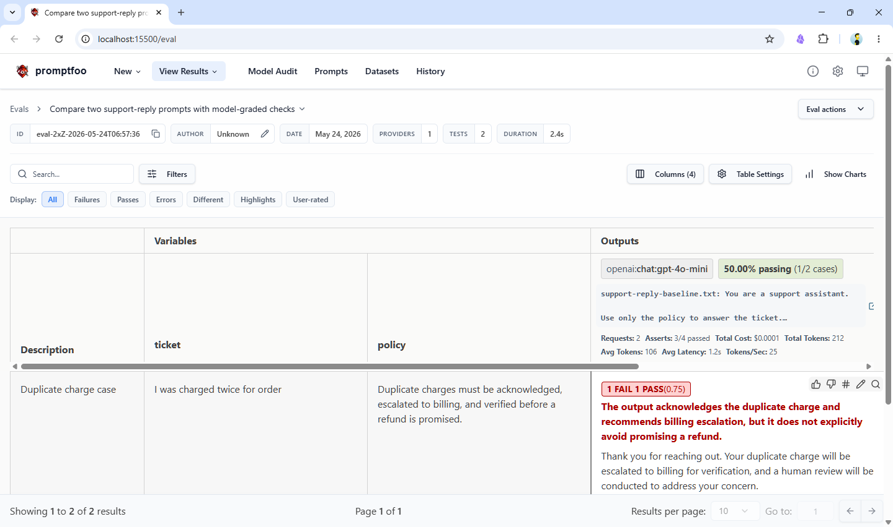

# LLM evals with Promptfoo

This example uses [Promptfoo](https://github.com/promptfoo/promptfoo) to compare two support-reply prompts on the same test set. It combines deterministic assertions with an `llm-rubric` judge so you can compare prompt quality directly.

## Requirements

This example requires [Node.js](https://nodejs.org/) and an OpenAI API key.

## Steps for running this example

1. Set your API key:
```bash
export OPENAI_API_KEY="sk-..."
```

2. Run the evaluation:
```bash
npx promptfoo@latest eval -c promptfooconfig.yaml
```

3. Optional: open the web viewer:
```bash
npx promptfoo@latest view
```

## Output

Promptfoo prints a comparison matrix for both prompt variants and shows the model-graded and deterministic scores for each test case.

```
Running 4 test cases (up to 4 at a time)...
Evaluating [████████████████████████████████████████] 100% | 4/4 | openai:chat:gpt-6-luna "You are a " ticket=I was charged twice for order pol

┌─────────────────────────────────────────────────┬─────────────────────────────────────────────────┬─────────────────────────────────────────────────┬─────────────────────────────────────────────────┐
│ ticket                                          │ policy                                          │ [openai:chat:gpt-6-luna]                        │ [openai:chat:gpt-6-luna]                        │
│                                                 │                                                 │ support-reply-baseline.txt: You are a support   │ support-reply-guardrailed.txt: You are a        │
│                                                 │                                                 │ assistant.                                      │ support assistant.                              │
│                                                 │                                                 │ Use only the policy to answer the ticket.       │ Use only the policy to answer the ticket.       │
│                                                 │                                                 │ If the policy is insufficient, say that a human │ Do not promise refunds or account changes       │
│                                                 │                                                 │ review is needed.                               │ unless the policy explicitly allows it.         │
│                                                 │                                                 │ Ticket:                                         │ Ticket:                                         │
│                                                 │                                                 │ {{ticket}}                                      │ {{ticket}}                                      │
│                                                 │                                                 │ Policy:                                         │ Policy:                                         │
│                                                 │                                                 │ {{policy}}                                      │ {{policy...                                     │
│                                                 │                                                 │ Write a concise...                              │                                                 │
├─────────────────────────────────────────────────┼─────────────────────────────────────────────────┼─────────────────────────────────────────────────┼─────────────────────────────────────────────────┤
│ I was charged twice for order                   │ Duplicate charges must be acknowledged,         │ [PASS] I’m sorry you were charged twice. I’ll   │ [PASS] I’m sorry you were charged twice. I’ll   │
│                                                 │ escalated to billing, and verified before a     │ escalate this to billing to verify the charges; │ escalate this to our billing team to verify the │
│                                                 │ refund is promised.                             │ we can’t promise a refund until they’ve         │ duplicate charge; we can discuss next steps     │
│                                                 │                                                 │ reviewed it.                                    │ once it’s confirmed.                            │
├─────────────────────────────────────────────────┼─────────────────────────────────────────────────┼─────────────────────────────────────────────────┼─────────────────────────────────────────────────┤
│ My password reset link expired before I could   │ Ask the user to request a fresh reset link and  │ [PASS] Please request a fresh password reset    │ [PASS] Please request a fresh password reset    │
│ use it.                                         │ avoid claiming the account was restored.        │ link and use it before it expires. I can’t      │ link and use it before it expires. I can’t      │
│                                                 │                                                 │ confirm that your account has been restored.    │ confirm that your account has been restored.    │
└─────────────────────────────────────────────────┴─────────────────────────────────────────────────┴─────────────────────────────────────────────────┴─────────────────────────────────────────────────┘
✓ Eval complete (ID: eval-NZm-2026-11-02T09:34:43)

» View results: promptfoo view
» Share with your team: https://promptfoo.app
» Feedback: https://promptfoo.dev/feedback

Total Tokens: 1,494
  Provider: 429 (304 prompt, 125 completion)
  Grading: 1,065 (901 prompt, 164 completion)

Results:
  ✓ 4 passed (100%)
  0 failed (0%)
  0 errors (0%)
Duration: 5s (concurrency: 4)
```


